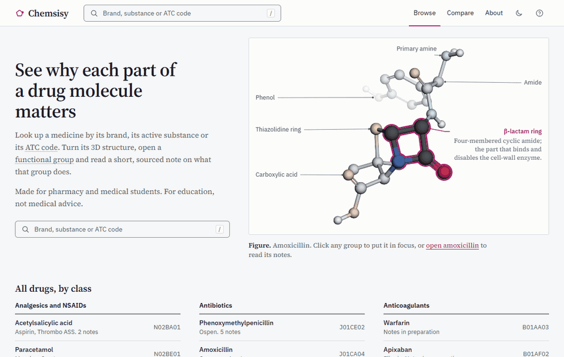
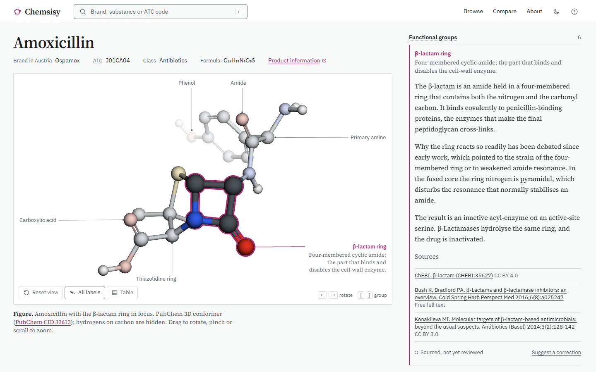

<p align="left"></p>

# Chemsisy

*Say "KEM-sis-ee".* An open-source molecule explorer that shows pharmacy and medical students why each part of a drug molecule matters.

> **For education. Not medical advice.** Chemsisy explains chemistry. It never gives indications, doses or side effects; every drug links to its official product information instead.



## What it does

- **Search the way you meet a drug.** By brand (Voltaren, Ospamox), by substance (diclofenac, amoxicillin) or by ATC code (M01AB05, or just C10 for all statins). Small typos are fine, and German spellings work too.
- **The molecule is the figure.** Each drug is a 3D structure with its functional groups found automatically and labelled like a textbook figure: a label, a leader line, a short caption. Pick a group and the molecule turns to show it, with the group in full colour and the rest faded.
- **Every note names its sources.** Open a group to read why it matters, in a few sentences, with the sources each claim rests on and an honest review status.
- **Compare two drugs.** Two molecules side by side, laid over each other by the core they share and turning together, with a table of the groups each one has.
- **Works on weak school Wi-Fi.** The 36-drug starter set is bundled. After one visit the app works with no connection at all, and it can be installed to the home screen.
- **Accessible.** Keyboard control of the 3D view, screen-reader labels, a text table as an alternative to the 3D view, WCAG AA in light and dark.

<picture>
  <source media="(prefers-color-scheme: dark)" srcset="docs/screenshots/drug-desktop-dark.png">
  
</picture>

## Use it offline

1. Open Chemsisy once while you have a connection. It stores the app, the fonts and all 36 drugs on your device in the background.
2. From then on it works without a network: search, every drug page and every comparison.
3. To keep it like an app, use **Add to Home Screen** on an iPad or phone, or the install button in the address bar on a computer.

There are no accounts, no ads, no tracking, no analytics and no cookies. The app keeps two settings in your browser: your theme and whether you have seen the tour.

## The starter set

36 drugs that pharmacy and medical students learn, in seven classes: analgesics and NSAIDs, antibiotics, anticoagulants, statins, antihypertensives, proton pump inhibitors and antidiabetics. Twelve of them have full notes so far (47 notes, plus 7 notes on what a comparison teaches); the others show their groups with "Note in preparation".

Every note shows its review status. "Sourced, not yet reviewed" means each claim cites a source you can open, but nobody has checked it yet. A note says "Reviewed by" a named person only after that person checked it.

## Data sources and licences

| What | Source | Licence |
|---|---|---|
| Structures, 3D conformers, computed properties | [PubChem](https://pubchem.ncbi.nlm.nih.gov/), US National Library of Medicine | Public domain |
| Two conformers PubChem does not provide (clarithromycin, dabigatran etexilate) | Generated with [RDKit](https://www.rdkit.org/) from the PubChem structure | BSD (RDKit) |
| Functional groups | SMARTS patterns in [`src/chem/rules.ts`](src/chem/rules.ts), matched with RDKit | MIT (patterns), BSD (RDKit) |
| ATC codes | [Wikidata](https://www.wikidata.org/), checked by hand | CC0 |
| Austrian brands and product information | [Medikamente Info Austria](https://medikamente.basg.gv.at/) (BASG), linked directly | Linked, not copied |
| European product information | [European Medicines Agency](https://www.ema.europa.eu/) EPARs | Linked, not copied |
| Chemical classes and roles | [ChEBI](https://www.ebi.ac.uk/chebi/) | CC BY 4.0 |
| Note sources | Open-access reviews on PubMed Central, ChEBI and other open references, cited in each note | As stated on each source |
| 3D viewer | [3Dmol.js](https://3dmol.org/) | BSD |
| Typefaces | Source Serif 4 and IBM Plex Sans | SIL Open Font Licence |

The ATC classification belongs to the WHO Collaborating Centre for Drug Statistics Methodology, which does not allow its index to be redistributed. Chemsisy shows only the codes, from Wikidata, and links to the [WHOCC](https://atcddd.fhi.no/) for the classification itself.

## Reuse the notes in your teaching

The notes, the glossary, the comparison notes and the curated drug list in [`content/`](content/) are licensed **CC BY 4.0**. You can copy them into slides, a Moodle course, a handout or an exam, change them and share them, including commercially. Two things in return:

1. Credit them, for example: *"Notes from Chemsisy (github.com/Henrycarto/chemsisy), CC BY 4.0."*
2. Keep the sources each note cites.

The notes are plain YAML, one file per drug in [`content/notes/`](content/notes/), so they are easy to copy from. Spotted a mistake or have a better source? Use **Suggest a correction** under any note; it opens a short form that asks for the change and a source.

## Run it yourself

```sh
npm ci
npm run dev        # development server
npm run build      # production build in dist/
npm run preview    # serve the build with the offline service worker
```

Tests, the data pipeline and how to propose changes are in [CONTRIBUTING.md](CONTRIBUTING.md). Security problems: see [SECURITY.md](SECURITY.md).

## Licence

Code: [MIT](LICENSE). Notes, glossary and drug list: [CC BY 4.0](content/LICENSE). Made by [Henry Carto](https://henrycarto.com).
