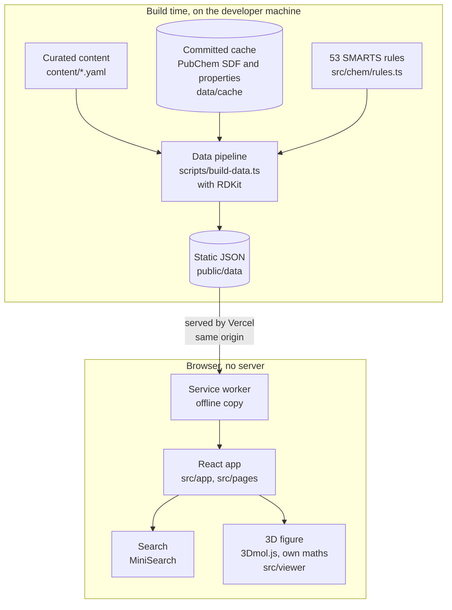
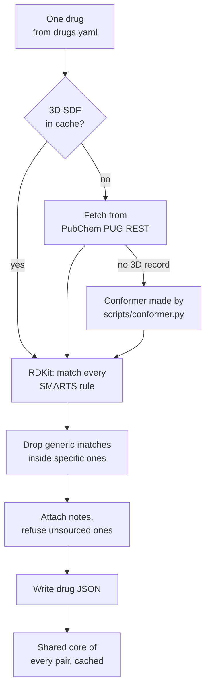

# Chemsisy, explained

This is a plain-language guide to what Chemsisy is, why it exists and how it is built. You do not need a background in chemistry, pharmacy or software to follow it. Technical terms are explained the first time they appear, and every term is in the [glossary](#glossary) at the end. For a longer explanation of the health IT standards and codes mentioned here (ATC in particular), see the [Health IT primer](https://github.com/Henrycarto/passayge/blob/main/docs/HEALTH_IT_PRIMER.md).

## In one sentence

Chemsisy is a free website that shows pharmacy and medical students a drug molecule in 3D, finds its important parts automatically, and explains in a few sourced sentences why each part matters.

## In one paragraph

Students learn medicines by their brand names (Voltaren, Ospamox) and by their ATC codes (a WHO code that sorts medicines into groups), but they are tested on chemistry: why a penicillin has a four-membered ring, why a statin carries a particular acid chain. Textbooks show flat drawings, and the 3D viewers that exist are built for researchers. Chemsisy starts where a student starts. You type a brand, a substance or an ATC code, and the drug opens as a 3D model you can turn. Its functional groups (the small arrangements of atoms that give a molecule its behaviour) are found by a computer program, not drawn by hand, and labelled like a textbook figure. Pick a group and the molecule turns to show it, with a short note that cites its sources and says honestly whether anyone has reviewed it. You can also lay two related drugs over each other to see what they share. The starter set holds 36 drugs, works offline after one visit, and never gives doses, indications or side effects: each drug links to its official Austrian or European product information instead.

## The real-world problem

### A short story

Mira Lechner is a second-year pharmacy student in Vienna, on a placement in a community pharmacy. (She is fictional, like everyone in this story.) A customer, Mr Josef Haberl, hands over a prescription for Ospamox and asks: "Is that the same as the penicillin I had last winter?"

The pharmacist answers "yes, both are penicillins", and Mira nods. But in the evening, revising for her medicinal chemistry exam, three questions remain:

1. **What is in Ospamox?** She knows the box, not the molecule. The brand hides the active substance, amoxicillin.
2. **What makes a penicillin a penicillin?** Her book says "the β-lactam ring" and shows a flat drawing. She cannot see which atoms that is, or why a ring of four atoms is special.
3. **What is different between the two drugs?** She would have to find both structures, draw them side by side and compare them by eye.

### What goes wrong

- **Students meet brands, books use substances.** In Austria, a student hears "Thrombo ASS" or "Pantoloc"; a chemistry book says "acetylsalicylic acid" or "pantoprazole". Linking the two takes a separate lookup.
- **Flat drawings hide shape.** A drug works because of its shape in three dimensions. A 2D drawing cannot show which way a ring faces or what sits next to it.
- **Research tools are too heavy.** Free 3D viewers exist, but they are built for proteins or for experts, and none puts short, sourced explanations on the molecule itself. The [research notes](research/phase-1.md) compare six of them.
- **Explanations are hard to trust or reuse.** Notes online rarely say where each claim comes from, and teaching material under non-commercial or no-derivatives licences cannot be freely copied into a teacher's slides.
- **School Wi-Fi is weak.** A tool that needs a fast connection in every lecture hall will not be used.

Chemsisy addresses all five: search by brand, substance or ATC code; a turnable 3D figure with the groups found by software; a light viewer chosen for small molecules; notes that cite open sources and are licensed CC BY 4.0; and a starter set that is stored on the device after one visit.

## The healthcare background you need

Short definitions follow. The [Health IT primer](https://github.com/Henrycarto/passayge/blob/main/docs/HEALTH_IT_PRIMER.md) explains ATC and the Austrian context in more depth; the chemistry terms are explained here.

**Active substance, brand and INN.** The active substance is the chemical that does the work, for example amoxicillin. A brand is the name a company sells it under, for example Ospamox. The INN (International Nonproprietary Name) is the official generic name of the substance; German INN spellings differ slightly (Metamizol, Acetylsalicylsäure). It is like a car model and the engine inside it: different badges, same engine.

**ATC code.** The Anatomical Therapeutic Chemical classification from the WHO Collaborating Centre in Oslo sorts medicines in five levels, from the body system down to the single substance. `C10AA05` is atorvastatin: C (cardiovascular system), C10 (lipid modifying agents), down to the substance. A substance can have more than one code: acetylsalicylic acid is `N02BA01` as a pain reliever and `B01AC06` as a blood thinner. Think of a library's shelf numbers, from the floor down to the exact book.

**Product information (SmPC, Fachinformation).** The official text for a medicine, approved by the regulator, with its uses, doses and side effects. In Austria, BASG (the Federal Office for Safety in Health Care) publishes it in Medikamente Info Austria; medicines approved for the whole EU have an EPAR (European Public Assessment Report) at the European Medicines Agency. Chemsisy links to these documents and leaves all clinical content to them. It is like linking to the manufacturer's manual instead of writing your own.

**Molecule, atoms and bonds.** A molecule is a set of atoms (carbon, oxygen, nitrogen and so on) held together by bonds. Atoms other than hydrogen are called heavy atoms. Drawings usually leave out the hydrogens on carbon because there are so many of them; Chemsisy does the same but keeps hydrogens on oxygen and nitrogen, which matter for how a drug binds. Think of a skeleton drawn without every small bone of the hand.

**3D conformer.** A molecule can bend and twist; one specific 3D arrangement of its atoms is a conformer. Chemsisy uses the computed conformer from PubChem for 34 drugs and generates one for the two molecules PubChem has none for. A conformer is one pose of a flexible object, like one photo of a dancer, not the only shape it can take.

**CPK colours.** The standard colours chemists use for elements: carbon grey or black, oxygen red, nitrogen blue, sulfur yellow. Chemsisy keeps them, tuned for light and dark mode, and fades atoms that are not in focus to a pale version of the same colour. It is a shared colour code, like red and green on traffic lights.

**Functional group.** A small arrangement of atoms that gives a molecule a typical behaviour, wherever it appears: a carboxylic acid can give up a proton, an ester can be split by the body, a β-lactam ring can react with a bacterial enzyme. Chemists reason about drugs group by group. Think of the parts of a key: the shaft and the bow do not matter much, the teeth decide which lock it opens.

**Pharmacophore.** The set of features a molecule needs to act on its target. Chemsisy has one rule labelled as a pharmacophore, the 3,5-dihydroxy acid chain of statins. It is the "teeth of the key" in the analogy above.

**Prodrug.** A medicine that is taken in an inactive form and turned into the active substance in the body, often by splitting an ester. Enalapril, ramipril and dabigatran etexilate are examples in the starter set, and dabigatran's page says it is the active form of the etexilate. Like a parcel that only becomes useful once unwrapped.

**Ionisable group and pKa.** Some groups gain or lose a proton (a hydrogen ion) depending on how acidic their surroundings are; the pKa is the acidity at which half of them have done so. A charged group behaves differently from an uncharged one, for example in how well it dissolves. Think of a coat a molecule takes on or off depending on the weather.

**Hydrogen-bond donor and acceptor.** A hydrogen on oxygen or nitrogen can be "lent" to a nearby oxygen or nitrogen; the lender is the donor, the receiver the acceptor. These weak bonds help a drug hold on to its target. Chemsisy shows the counts PubChem computes. It is like velcro: hooks on one side, loops on the other.

**Stereocentre and enantiomer.** A stereocentre is an atom whose four neighbours can be arranged in two mirror-image ways. The two mirror-image molecules are enantiomers; they have the same atoms and bonds but can act differently in the body. Ibuprofen is a mix of both; dexibuprofen is one of them. Like a left and a right glove.

**SMILES.** A way to write a molecule as one line of text: `CC(=O)O` is acetic acid (two carbons, a double-bonded oxygen and an OH). Chemsisy's tests use SMILES to describe small test molecules. It is like writing a route as street names instead of drawing a map.

**SMARTS.** A pattern language built on SMILES that describes a part of a molecule to search for, with wildcards and conditions: "a carbon double-bonded to an oxygen and single-bonded to an OH" is a carboxylic acid. Chemsisy's 53 functional-group rules are SMARTS patterns. Think of a search pattern for text, but for atoms and bonds.

**SDF (structure-data file).** A plain text file format for molecules: a list of atoms with x, y and z coordinates, then a list of bonds. Chemsisy stores each drug's 3D structure as an SDF. It is a molecule's assembly instructions.

**PubChem and CID.** PubChem is the free chemistry database of the US National Library of Medicine. Every compound has a number, the CID; amoxicillin is CID 33613. Its data is public domain. Think of it as a public catalogue of chemicals with a stock number for each.

**ChEBI.** Chemical Entities of Biological Interest, a curated dictionary of chemicals and their roles from the European Bioinformatics Institute, licensed CC BY 4.0. Many of Chemsisy's notes cite ChEBI entries. It is a specialist encyclopedia for small molecules.

**Shared core (maximum common substructure).** The largest piece of molecule that two molecules have in common. Amoxicillin and penicillin V share a 17-atom core. Chemsisy uses it to lay one molecule over the other. Like finding the common floor plan of two houses before comparing their extensions.

**β-lactam ring.** A ring of four atoms (three carbons and one nitrogen) with a double-bonded oxygen: an amide bent into a tight square. It is the reactive centre of penicillins and cephalosporins, which bind to and disable the bacterial enzymes that build the cell wall. It serves as the running example in Chemsisy (the home page opens on it). Think of a spring held under tension, ready to snap.

## What it does, step by step

Here is one journey, as Mira would experience it, with what happens underneath.

1. **Mira opens Chemsisy.** The browser downloads the app, the fonts and a small index of all 36 drugs (`public/data/index.json`). A service worker (a small background script the browser keeps) quietly stores the app and every drug file on her device (`vite.config.ts`). A five-step tour explains the screen once (`src/components/Tour.tsx`). The home page shows amoxicillin with its β-lactam ring in focus.
2. **She types "Ospamox".** The search runs entirely in her browser on the bundled index (`src/search/search.ts`). It matches brand names, substance names, synonyms and German spellings, tolerates small typos ("amoxicilin" still works) and ignores accents. An ATC code or the start of one (`J01`, `C10AA`) lists every drug in that group. The suggestion says "Brand Ospamox", so she knows why it matched.
3. **The amoxicillin page opens** at `/drug/amoxicillin`. At the top: brand in Austria (Ospamox), ATC `J01CA04`, class, formula C₁₆H₁₉N₃O₅S, and a link to the official product information PDF at BASG. Below: the 3D figure, with a label and a thin leader line for each of the six functional groups the software found: β-lactam ring, thiazolidine ring, carboxylic acid, amide, primary amine and phenol.
4. **She opens "β-lactam ring".** In about a quarter of a second (240 ms, skipped if her device asks for reduced motion), the molecule turns so the four-atom ring faces her. The ring is drawn in full colour with a magenta halo; the rest of the molecule fades. The address changes to `?group=beta_lactam`, so a teacher could link straight to this view.
5. **She reads the note.** Three short paragraphs in plain words, then the sources: a ChEBI entry and two open-access review articles on PubMed Central, each with its licence. A label says "Sourced, not yet reviewed": every claim cites a source, but no chemist or pharmacist has checked it yet. The first mention of each glossary term in a note (16 terms, such as "prodrug" or "functional group") has a dotted underline; hovering, focusing or tapping shows a short definition with its own source.
6. **She uses the keyboard.** Arrow keys turn the molecule, plus and minus zoom, `[` and `]` step through the groups, `0` resets the view, Escape clears the focus. A screen reader announces the group in focus. A "Table" button replaces the 3D view with a text table of every group and its atoms, numbered as in the structure file.
7. **She compares with penicillin V.** Under "Compare with" she picks "What the side chain changes". At `/compare/phenoxymethylpenicillin/amoxicillin` two figures turn together. Amoxicillin is laid over penicillin V by their shared 17-atom core, which is highlighted; a "Differences" button highlights what only one drug has instead. A table lists each functional group with "Yes" or "No" for each drug, and a sourced note explains that the two share the same penam core and differ only in the side chain at position 6.
8. **The Wi-Fi drops.** Nothing changes: search, every drug page and every comparison come from the copy stored on her device. She can also add Chemsisy to her home screen like an app.

Behind all of this sits a step Mira never sees: the build pipeline. Before the app is published, a script reads the curated drug list, takes each drug's 3D structure from PubChem, finds the functional groups with RDKit (an open-source chemistry toolkit), computes the shared core of every pair, attaches the notes and writes the JSON files the app loads (`scripts/build-data.ts`). The app itself does no chemistry calculations at run time.

## How it is built

The data pipeline only touches the network to fill gaps in the cache:

### The parts

| Part | What it is | Why it exists | Talks to |
|---|---|---|---|
| **Curated content** ([content/](../content/)) | `drugs.yaml` (36 drugs: PubChem CID, class, ATC codes, synonyms, Austrian brands with authorisation numbers, the one product document), `notes/<drug>.yaml` (one note per group, keyed by rule id), `comparisons.yaml` (7 comparison notes), `glossary.yaml` (16 terms). | The hand-checked part, licensed CC BY 4.0 so teachers can reuse it. | Read by the pipeline. |
| **Functional-group rules** ([src/chem/rules.ts](../src/chem/rules.ts)) | 53 SMARTS patterns, each with a priority, optionally the ring atoms to turn face-on and the atoms a label should point at. `resolveOverlaps()` and `groupMatches()` clean up the raw matches. | The chemistry, as data. The same file is used by the pipeline and the tests. | RDKit, in the pipeline and in the tests. |
| **Data pipeline** ([scripts/build-data.ts](../scripts/build-data.ts)) | A Node script (`npm run data`): loads RDKit's WebAssembly build, reads each drug's SDF, matches every rule, attaches notes, computes shared cores for all pairs, writes `public/data`. | So the app needs no chemistry engine and no network. | PubChem (only for cache misses), the cache, the content files. |
| **Committed cache** ([data/cache/](../data/cache/)) | PubChem 3D SDFs, computed properties, two generated conformers and the pair cache. | A rebuild works offline and gives the same output. | The pipeline. |
| **Conformer script** ([scripts/conformer.py](../scripts/conformer.py)) | Python with RDKit: takes PubChem's 2D structure, adds hydrogens, embeds in 3D with ETKDG (fixed seed `0xC0FFEE`) and relaxes with MMFF94. | PubChem has no 3D conformer for clarithromycin and dabigatran etexilate. | PubChem (2D record), writes `data/cache/sdf-generated/`. |
| **Static data** ([public/data/](../public/data/)) | `index.json` (summaries, classes, comparisons, glossary), one JSON per drug (SDF, groups, notes, properties, links), `pairs.json` (509 shared cores). | What the app loads. | Served as files; cached by the service worker. |
| **App shell** ([src/app/](../src/app/), [src/pages/](../src/pages/)) | React 19: a 55-line history router with four routes (home, drug, compare, about), a data provider, and the pages. | The screens. | Only its own origin (`src/data/load.ts`). |
| **Search** ([src/search/search.ts](../src/search/search.ts)) | MiniSearch over names, brands and synonyms with accent folding, prefix and fuzzy matching; a separate path for ATC codes and prefixes. | "Search the way you meet a drug." | The index in memory. |
| **Molecule figure** ([src/viewer/figure.ts](../src/viewer/figure.ts), [src/components/MoleculeView.tsx](../src/components/MoleculeView.tsx)) | `MoleculeFigure` wraps a 3Dmol.js viewer with an SVG focus halo behind the canvas and HTML labels and SVG leader lines in front. `MoleculeView` is the React wrapper with keyboard control. | The textbook figure you can turn. | 3Dmol.js; the maths and label modules. |
| **Orientation maths** ([src/viewer/math.ts](../src/viewer/math.ts)) | Small dependency-free 3D maths: Jacobi eigen-decomposition, principal axes, `faceGroup()`, Horn's superimposition, quaternions and slerp. | Turning a group to the reader and laying two molecules over each other. | Used by the figure and the comparison. |
| **Label placement** ([src/viewer/labels.ts](../src/viewer/labels.ts)) | `placeLabels()`: pure function on the projected screen geometry. | Labels that never cover atoms or cross each other. | The figure. |
| **Comparison** ([src/viewer/compare.ts](../src/viewer/compare.ts), [src/pages/ComparePage.tsx](../src/pages/ComparePage.tsx)) | `coreTransform()`, `coreRmsd()` and `shareView()`: superimpose B on A by the shared core and link the two cameras. | "Compare two drugs." | Both figures. |
| **Notes and tooltips** ([src/components/Note.tsx](../src/components/Note.tsx), [Tooltip.tsx](../src/components/Tooltip.tsx), [Term.tsx](../src/components/Term.tsx)) | The note body with glossary terms linked on first mention, sources with licences, review status, "Suggest a correction". Tooltips with Floating UI that open on hover, focus and tap. | Sourced, honest explanations. | The glossary in the index; GitHub's issue form for corrections. |
| **Offline (PWA)** ([vite.config.ts](../vite.config.ts)) | vite-plugin-pwa generates a Workbox service worker that precaches the app shell, fonts and every file in `public/data`. | Works on weak school Wi-Fi. | The browser cache. |
| **Repository checks** ([scripts/check-privacy.mjs](../scripts/check-privacy.mjs), [check-house-rules.mjs](../scripts/check-house-rules.mjs), [check-size.mjs](../scripts/check-size.mjs)) | No personal data and one fixed User-Agent in request code; house typography rules; a build-size budget. | Privacy and a light download, enforced in CI. | Tracked files and `dist/`. |
| **Hosting** ([vercel.json](../vercel.json)) | Static hosting on Vercel with a strict Content Security Policy (everything `'self'`), `no-referrer`, and long caching for hashed assets. | No server needed; the browser may only talk to the site itself. | The browser. |
| **Review tools** ([scripts/review-sheet.mjs](../scripts/review-sheet.mjs), [apply-review.mjs](../scripts/apply-review.mjs)) | Writes a self-contained HTML sheet to check one drug's notes claim by claim; applies the ticked results back to the YAML. | So "Reviewed by" is only ever set after a real review. | `content/notes/`. |

## The technology stack

Versions are from `package.json` and `package-lock.json`. Reasons marked "research notes" come from [docs/research/phase-1.md](research/phase-1.md).

| Item | Version | What it does here | Why this one |
|---|---|---|---|
| TypeScript | 6.0.3 | The language for the app, the pipeline and the tests. | One set of types for the JSON the pipeline writes and the app reads (`src/data/types.ts`). A comparison with plain JavaScript is not recorded: not confirmed. |
| Node.js | 22 (`engines`: 22.6 or newer) | Runs the pipeline, tests and build. | The pipeline runs TypeScript directly with `--experimental-strip-types`, which needs a recent Node. |
| React | 19.3.1 | The user interface. | Named in the proposed stack in the research notes; why it was chosen over other frameworks is not recorded: not confirmed. |
| Vite | 8.3.5 | Development server and production build; splits 3Dmol.js into its own lazily loaded chunk. | Proposed stack in the research notes; the alternatives are not compared: not confirmed. |
| 3Dmol.js (`3dmol`) | 2.5.5 | Draws the 3D molecule with WebGL. | Research notes: compared with Mol* and NGL. Smallest (157 KB gzipped against 1.50 MB for Mol*'s prebuilt viewer), BSD licence, built for small molecules, and it has `modelToScreen()` and `setViewChangeCallback()` for an own label overlay and `linkViewer()` for synced comparisons. |
| RDKit.js (`@rdkit/rdkit`) | 2026.9.1 | Reads structures, matches SMARTS, finds the shared core of each pair. Used at build time and in tests only. | Research notes: the engine is 2.4 MB gzipped, so precomputing for the starter set keeps the first load small. Alternatives such as Open Babel are not discussed: not confirmed. |
| RDKit (Python) | not pinned | Generates the two missing conformers (`scripts/conformer.py`). | Run once; output committed. The version used is not recorded: not confirmed. |
| fontTools (Python) | not pinned | Subsets the two typefaces (`scripts/fonts.py`). | The prebuilt webfont packages drop the subscript digits chemical formulas need. |
| MiniSearch | 7.2.0 | Fuzzy, prefix, accent-insensitive search in the browser. | Research notes: typo tolerance, prefix search and synonyms such as "ASS". A comparison with Fuse.js or Lunr is not recorded: not confirmed. |
| Floating UI (`@floating-ui/react`) | 0.27.20 | Positions tooltips and wires hover, focus, tap and Escape. | Research notes ("Floating UI for tooltips, styled by us"); alternatives not compared: not confirmed. |
| vite-plugin-pwa with Workbox | 2.0.0 (`workbox-window` 7.4.1) | Generates the service worker and the web app manifest. | Research notes: offline use on weak Wi-Fi. |
| yaml | 2.9.1 | Parses the content files. | Content is plain YAML so teachers can copy from it (README). |
| Source Serif 4, IBM Plex Sans | font files in `src/fonts/` | Reading text and interface. | Design notes ([design/direction.md](../design/direction.md)): real Greek β, subscript digits, tabular figures; other fonts rejected for missing Greek or proportional digits. |
| Vitest | 5.0.5 | Unit tests in Node. | Not recorded: not confirmed. |
| Playwright with @axe-core/playwright | 1.64.1, 4.14.0 | Browser tests in Chromium (desktop and phone), accessibility checks, offline test. | Named in the research notes' stack. WebGL runs in software (SwiftShader) so CI can draw the molecule. |
| ESLint with typescript-eslint and react-hooks | 10.13.0, 8.72.0, 7.1.1 | Code checks. | Run in CI. |
| GitHub Actions | `actions/checkout@v5`, `setup-node@v5` | One CI job with every check (below). | Runs on every push to `main` and every pull request. |
| Vercel | not applicable | Hosts the static build with security headers (`vercel.json`). | No server is needed. |

`jsdom` 30.1.3 is listed as a development dependency, but the unit tests run in the `node` environment (`vitest.config.ts`) and no file imports it; whether it is still needed is not confirmed.

## The hard parts and how they were solved

### 1. Finding functional groups automatically, without false names

**Problem.** A molecule like amoxicillin contains a carboxylic acid inside a larger pattern, an amide inside its β-lactam ring, and so on. A naive search would label the same atoms three times ("carboxylic acid", "arylpropionic acid", "acid"), or miss groups because of how the software represents rings. And the indices RDKit returns must point at exactly the same atoms the 3D viewer draws.

**Solution.** Each of the 53 rules is a SMARTS pattern with a priority. When one match covers every atom of another, lower-priority match, the specific name wins ("2-arylpropionic acid" replaces "carboxylic acid"); matches that only partly overlap are both kept, because they are different groups that share atoms (`resolveOverlaps()`). Several matches of one rule merge into one group with a count. Patterns for aromatic rings are written in aromatic form, because the research found RDKit does not perceive aromaticity in SMARTS queries. The pipeline refuses an SDF where hydrogens are not listed after all heavy atoms (`assertHeavyFirst()`), so the heavy-atom numbers RDKit uses are the same as the atom numbers in the 3D file. It also refuses a note for a group that was not detected, and a note without a source.

**Where.** `RULES`, `resolveOverlaps()`, `groupMatches()` in `src/chem/rules.ts`; `assertHeavyFirst()` and `loadNotes()` in `scripts/build-data.ts`. Tested in `tests/unit/rules.test.ts`: every rule has at least one molecule it must match and one it must not (a starter-set drug or a SMILES string), every pattern is valid SMARTS, the pipeline output for seven drugs is exactly the expected set of groups, and no drug shows both "benzimidazole" and the "imidazole" inside it.

### 2. Turning a group towards the reader

**Problem.** Picking a group should turn the molecule so that group is clearly visible: a ring seen face-on, not edge-on, with no other atoms in front of it, and the whole molecule still fitting the frame. 3Dmol.js has no such function.

**Solution.** `faceGroup()` computes the plane of the ring from the ring atoms' coordinates (the direction of least spread, from a small Jacobi eigen-decomposition) and rotates that plane to face the screen. It then flips the molecule if most of its atoms would be in front of the ring, so the bulk sits behind. A two-atom group is laid flat in the screen instead. Finally it tries every spin about the viewing axis in 3-degree steps and keeps the one that fits the free area of the frame best. The figure animates from the old view to the new one in 240 ms with quaternion interpolation (slerp), and jumps straight there when the user prefers reduced motion.

**Where.** `faceGroup()`, `planeNormal()`, `jacobi()`, `slerp()` in `src/viewer/math.ts`; `orient()` in `src/viewer/figure.ts`. Tested in `tests/unit/geometry.test.ts`: for amoxicillin, penicillin V and cefuroxime the β-lactam ring faces the reader to better than 0.999 with no atom in front of it, and every single ring group in the starter set (more than 30) can be shown face-on without ring atoms overlapping on screen.

### 3. Textbook labels that never cross the molecule or each other

**Problem.** A textbook figure has labels at its edges with thin leader lines to the right atoms. Done badly, leaders cross bonds, run through other labels, or cross each other, and the figure becomes unreadable. The layout has to be recomputed every time the molecule stops turning, on screens from a phone to a desktop.

**Solution.** `placeLabels()` is a pure function on the projected 2D geometry (atom discs and bond segments), so it can be tested without a browser. Each label gets candidate positions in columns at the left and right edges (or rows at the top and bottom on narrow figures). A candidate is rejected if the label box touches any atom, bond or other label, or if its leader touches any atom other than its target, heads back past its own label, or comes within 8 pixels of another leader. Among the rest, the shortest and flattest leader wins. Placement is greedy, so four label orders are tried and the one that places the most labels wins. A label that cannot be placed cleanly is left out of the figure; the group list beside it always names every group. Amines point at their nitrogen, not at the carbon next to it (the `anchor` field in the rules).

**Where.** `placeLabels()`, `leadersClash()`, `leaderHitsMolecule()` in `src/viewer/labels.ts`; `layout()` in `src/viewer/figure.ts`. Tested in `tests/unit/geometry.test.ts` across all 36 drugs: no leader touches the molecule, no two labels overlap, no two leaders cross in either layout, more than 95 % of labels are placed in the column layout and more than 80 % in the phone row layout (a comment in the test records 99 of 121), and a primary amine label always ends on a nitrogen.

### 4. Laying two molecules over each other

**Problem.** Comparing two drugs side by side only helps if they are turned the same way and their common part sits in the same place. That needs the shared core of the two molecules, which is slow to compute, and then the best rotation of one onto the other.

**Solution.** The pipeline computes the maximum common substructure of every pair with RDKit at build time, on heavy atoms only (the design notes record that it timed out at 5 seconds with hydrogens and took 187 ms without), with complete rings only and a 2-second limit per pair. Pairs that share fewer than 6 atoms get no core. The results are cached, so a rebuild skips the slow part. In the browser, `coreTransform()` uses Horn's method (the rotation that best maps one set of points onto another, found as the top eigenvector of a 4 x 4 matrix) to move molecule B onto molecule A's core. `shareView()` gives both figures one camera, fits both molecules, and links the two viewers so they turn together.

**Where.** The pair loop in `scripts/build-data.ts`; `superimpose()` in `src/viewer/math.ts`; `coreTransform()`, `coreRmsd()`, `shareView()` in `src/viewer/compare.ts`. Tested in `tests/unit/geometry.test.ts`: superimposition recovers a known rotation to six decimal places, and for amoxicillin and penicillin V the shared core is 17 atoms and lies within 1.0 ångström (root-mean-square) after superimposition.

### 5. Offline, private and honest by construction

**Problem.** The app must work with no network after one visit, must not track students, and its notes must stay within chemistry and never claim a review that did not happen.

**Solution.** The service worker precaches the app, fonts and all 36 drug files, and takes control on the first visit, so a drug the student has never opened still loads offline. The app only ever loads files from its own origin, which the Content Security Policy on Vercel enforces (`connect-src 'self'`). The only stored data are two settings in the browser (theme and whether the tour was seen). In the repository, a privacy script fails if the maintainer's email address appears in any tracked file (it compares SHA-256 hashes, so the script does not contain the address), if any email address appears in code, or if request code uses a User-Agent other than `Chemsisy/0.1 (https://henrycarto.com)`. Content tests fail on a note without an `https` source, on a "reviewed" note without a named reviewer and role, on a caption longer than 90 characters, and on clinical wording (doses in mg, "dose", "indication", "side effects" and similar). The pipeline enforces the same source and reviewer rules.

**Where.** `vite.config.ts`, `src/main.tsx`, `vercel.json`, `scripts/check-privacy.mjs`, `tests/unit/content.test.ts`, `loadNotes()` in `scripts/build-data.ts`. Tested in the browser by `tests/e2e/offline.spec.ts` ("after one visit, the starter set works with the network off": opens pantoprazole and a comparison, and searches for "Sortis", with the network switched off).

## How we know it works

Counts below are from running every suite locally on 24 October 2026, on commit `6dbd7e8`. Nothing failed.

| Suite | Command | Tests | What it proves |
|---|---|---|---|
| SMARTS rules and overlap logic | `npm test` (`tests/unit/rules.test.ts`) | 172 passed | Every one of the 53 rules matches its positive molecules and none of its negatives; every pattern is valid; overlap resolution and merging; the exact groups the pipeline finds for seven drugs. |
| Search | `npm test` (`tests/unit/search.test.ts`) | 26 passed | The ten Austrian test brands find the right substance; typos; German INN spellings and synonyms; ATC codes and prefixes; no false hits. |
| Geometry and labels | `npm test` (`tests/unit/geometry.test.ts`) | 16 passed | Face-on rings, rotation maths, superimposition, label and leader placement across the whole starter set. |
| Content rules | `npm test` (`tests/unit/content.test.ts`) | 13 passed | 36 drugs in 7 classes; ATC format; product links to BASG or EMA (or a stated reason); sourced notes; honest review status; no clinical wording; glossary covers every term a rule points to; no em dashes; YAML parses. |
| Browser tests | `npm run test:e2e` (Playwright, Chromium) | 36 run: 32 passed, 4 skipped, 0 failed, in 2.0 minutes | Each of 18 tests runs on a desktop (1440 x 900) and a phone (Pixel 7) profile. axe finds no WCAG 2.2 A or AA violations on home, drug, compare and about, in light and dark; tooltips on hover, focus and tap; the tour; keyboard control of the viewer; the text table; brand search; source links and review status; the not-medical-advice statement; offline. The 4 skips are by design: hover and keyboard tests do not run on the phone profile, the tap test does not run on desktop. |

That is 227 unit tests and 36 browser test runs (18 tests on two devices).

**Other checks, all passing in the same run:** `npm run typecheck` (no errors), `npm run lint` (no findings), `npm run check` (privacy check and house rules over 269 tracked files), `npm run build`, and the size budget:

| Budget item | Measured | Limit |
|---|---|---|
| App entry JavaScript (gzip) | 103.4 kB | 110 kB |
| 3D viewer chunk (gzip, loaded on demand) | 158.6 kB | 190 kB |
| Fonts (WOFF2) | 370.8 kB | 400 kB |
| Starter-set data (gzip) | 130.4 kB | 350 kB |
| Everything the offline cache stores (raw) | 1,795.3 kB | 2,662.4 kB |

**The pipeline is reproducible.** Re-running `npm run data` from the committed cache took about 4 seconds, printed "36 drugs, 509 pairs with a shared core of 6+ atoms, 47 notes", and changed only the generation date in `public/data/index.json` (which was then restored).

**No Python test suite exists.** The two Python scripts (`scripts/conformer.py`, `scripts/fonts.py`) are one-off generators with no tests; Python RDKit is not installed on the test machine, so `conformer.py` was not re-run. Its output for the two drugs is committed in `data/cache/sdf-generated/`. The optional link check (`npm run data -- --check-links`, which sends a request to every BASG and EMA link) was not run for this write-up.

**Continuous integration** (`.github/workflows/ci.yml`) has one job, "Typecheck, lint, unit tests, checks, build and browser tests", on every push to `main` and every pull request: install, privacy check, house rules, typecheck, lint, unit tests, build, size budget, install Chromium, browser tests (with one retry in CI). The latest run, on commit `6dbd7e8` ("Upgrade CI actions to v5", 23 October 2026), succeeded in 12 minutes 25 seconds. The run before it also succeeded; the one before that was cancelled when a newer push superseded it (the workflow cancels runs in progress for the same branch).

**Validation against official sources.** There is no formal validator for this kind of content. What exists: every SMARTS pattern is checked by RDKit itself; each ATC code is checked against the format `A00AA00` in the tests and was checked by hand against Wikidata (`content/drugs.yaml`); Austrian brands were checked in Medikamente Info Austria on 23 October 2026 (comment in `content/drugs.yaml`); accessibility is checked with axe against the WCAG tags `wcag2a`, `wcag2aa`, `wcag21a`, `wcag21aa` and `wcag22aa`. The chemistry in the notes has not been reviewed by a chemist or pharmacist; the app says so on every note.

## What is deliberately simplified or left out

| Simplification | Why |
|---|---|
| No clinical content: no indications, doses or side effects. | Chemsisy explains chemistry; the official product information covers the rest and is linked from every drug. Enforced by a content test. |
| 36 drugs in 7 classes; no lookup of drugs outside the set. | The research notes planned live lookups with RDKit in the browser as a stretch goal; it is not built. The RDKit engine is 2.4 MB gzipped, which would weigh on school Wi-Fi. |
| Notes for 12 of the 36 drugs (47 group notes, plus 7 comparison notes); the rest say "Note in preparation". | The research notes call the notes "the long pole": writing sourced notes is the slow part. |
| Every note is "Sourced, not yet reviewed". | No named reviewer has checked them yet; a note is only marked reviewed after a real review (`scripts/review-sheet.mjs`, `scripts/apply-review.mjs`). |
| One 3D conformer per drug, not the shape the drug takes in its target. | PubChem's computed conformer is a reasonable, public-domain pose; the figure caption names its source. |
| Two conformers are generated, not from PubChem. | PubChem computes none for very large molecules (clarithromycin, dabigatran etexilate). Their pages say so. |
| Hydrogens on carbon are hidden. | Textbook convention; polar hydrogens stay because they take part in hydrogen bonds. |
| Salts are mapped to the parent compound (for example diclofenac sodium to diclofenac). | The functional groups belong to the active molecule; the synonyms keep the salt names searchable. |
| 53 hand-written SMARTS rules. | Enough for the starter set (every rule is used by at least one drug), but a new drug can have groups no rule names. |
| ATC codes only, from Wikidata; no ATC names or hierarchy. | The WHO Collaborating Centre does not allow its index to be redistributed or changed, and the code is MIT licensed, so anyone may use it commercially. Chemsisy links to the WHOCC instead. |
| Shared cores only for pairs with 6 or more common atoms (509 of the 630 possible pairs). | Below that, the overlay would mislead; those pairs are shown side by side and the page says why. |
| Labels that cannot be placed cleanly are left out of the figure. | A clean figure matters more than a complete one; the group list and the table always name every group. |
| XLogP and polar surface area are fetched from PubChem and stored, but not shown. | Only molar mass and hydrogen-bond donors and acceptors appear on the drug page; why the other two are hidden is not confirmed. |
| Comparisons of mirror-image pairs (ibuprofen and dexibuprofen, omeprazole and esomeprazole) have no note yet. | The research notes list them as "after the first 12"; each needs its own open review article. |

## Glossary

**Accessibility.** Making software usable by people with disabilities, for example with a keyboard only or a screen reader.

**Active substance.** The chemical in a medicine that has the effect, such as amoxicillin.

**Ångström.** One ten-billionth of a metre, the usual unit for distances between atoms.

**ATC code (Anatomical Therapeutic Chemical).** WHO's five-level code that groups medicines by body system, effect and substance, for example `C10AA05` for atorvastatin.

**axe.** An automated accessibility checker that tests a page against the WCAG guidelines.

**BASG (Bundesamt für Sicherheit im Gesundheitswesen).** The Austrian Federal Office for Safety in Health Care, which authorises medicines and publishes their product information in Medikamente Info Austria.

**β-lactam ring.** A four-membered ring containing an amide; the reactive core of penicillins and cephalosporins.

**Brand.** The name a company sells a medicine under, such as Ospamox or Voltaren.

**ChEBI (Chemical Entities of Biological Interest).** A curated, CC BY 4.0 dictionary of small molecules and their roles.

**CI (continuous integration).** Automated checks that run on every change to the code, here on GitHub Actions.

**CID (Compound ID).** PubChem's number for a compound; amoxicillin is 33613.

**Conformer.** One specific 3D arrangement of a flexible molecule's atoms.

**Content Security Policy (CSP).** A rule set a website sends to the browser that says where the page may load scripts, styles and data from.

**CPK colours.** The standard element colours in molecule pictures: carbon grey, oxygen red, nitrogen blue, sulfur yellow.

**EMA (European Medicines Agency).** The EU agency that assesses medicines authorised for the whole EU.

**Enantiomer.** One of two mirror-image forms of a molecule with a stereocentre.

**EPAR (European Public Assessment Report).** EMA's public documents for a centrally authorised medicine, including its product information.

**ETKDG and MMFF94.** A method that places a molecule's atoms in 3D from its bonds (ETKDG), and a force field that relaxes the result into a realistic shape (MMFF94). Both are in RDKit.

**Functional group.** A small arrangement of atoms that gives a molecule a typical chemical behaviour.

**Heavy atom.** Any atom that is not hydrogen.

**Horn's method.** A mathematical method that finds the rotation that best lays one set of points over another.

**Hydrogen-bond donor and acceptor.** The partner that lends a hydrogen (donor) and the one that receives it (acceptor) in a weak bond between molecules.

**INN (International Nonproprietary Name).** The official generic name of an active substance.

**Ionisable group.** A group that gains or loses a proton depending on acidity, and so can carry a charge.

**JSON.** A simple text format for structured data.

**Leader line.** The thin line from a label to the part of a figure it names.

**Maximum common substructure (MCS).** The largest piece two molecules have in common; Chemsisy calls it the shared core.

**Mermaid.** A text format for diagrams that GitHub draws as pictures.

**MiniSearch.** A small JavaScript search library that runs in the browser.

**Offline cache (precache).** Files the service worker stores on the device in advance so the app works without a network.

**pKa.** The acidity at which half of an ionisable group has lost its proton.

**Pharmacophore.** The set of features a molecule needs to act on its target.

**Product information (SmPC, Fachinformation).** The regulator-approved text for a medicine, with uses, doses and side effects.

**Prodrug.** A medicine taken in an inactive form and converted to the active substance in the body.

**PubChem.** The public-domain chemistry database of the US National Library of Medicine.

**PWA (progressive web app).** A website that can be installed to the home screen and work offline, thanks to a service worker.

**RDKit.** An open-source chemistry toolkit; Chemsisy uses its WebAssembly build in Node and its Python version for two conformers.

**Review status.** The label on each note: "Sourced, not yet reviewed" by default, "Reviewed by [name, role]" only after a named person has checked it.

**RMSD (root-mean-square deviation).** The typical distance between matching atoms of two superimposed structures.

**SDF (structure-data file).** A text file format listing a molecule's atoms with 3D coordinates and its bonds.

**Service worker.** A small script the browser runs in the background that can store files and answer requests when there is no network.

**Shared core.** Chemsisy's name for the maximum common substructure of two drugs.

**SMARTS.** A pattern language for searching parts of molecules, built on SMILES.

**SMILES.** A way of writing a molecule as one line of text, such as `CC(=O)O` for acetic acid.

**Stereocentre.** An atom whose neighbours can be arranged in two mirror-image ways.

**Superimposition.** Moving and rotating one molecule so that matching atoms lie as close as possible to those of another.

**Transpeptidase.** A bacterial enzyme that builds the cross-links of the cell wall; β-lactam antibiotics disable it.

**WCAG (Web Content Accessibility Guidelines).** The international standard for accessible websites.

**WebAssembly.** A compact program format that browsers and Node can run at near-native speed; RDKit.js is compiled to it.

**WebGL.** The browser's interface to the graphics card, used by 3Dmol.js to draw molecules.

**WHOCC.** The WHO Collaborating Centre for Drug Statistics Methodology in Oslo, which maintains the ATC classification.

**Wikidata.** A free, CC0-licensed knowledge base; Chemsisy takes ATC codes from it and checks them by hand.
